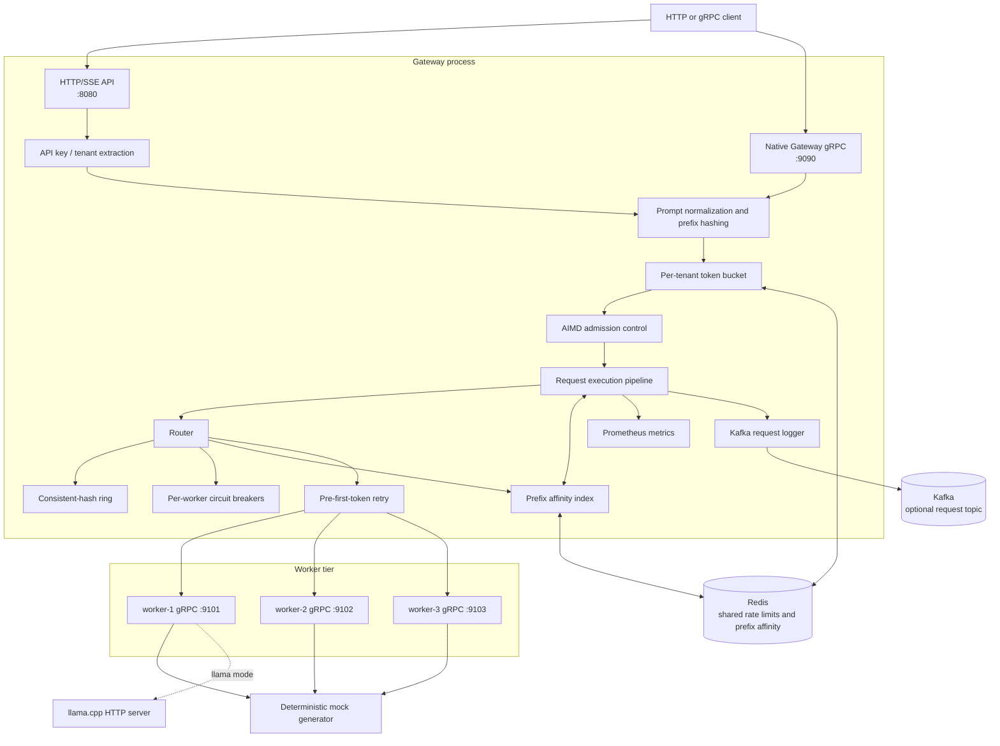
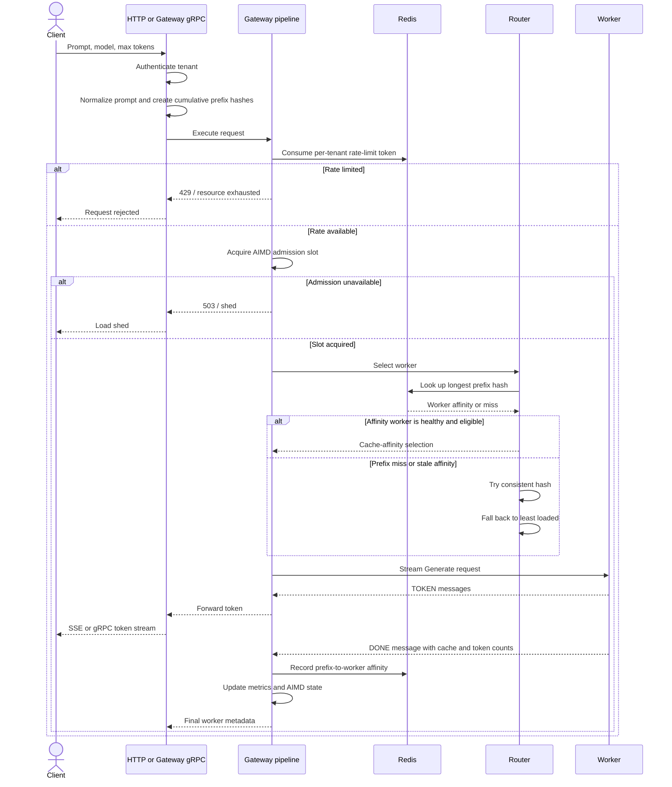
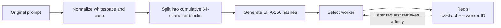
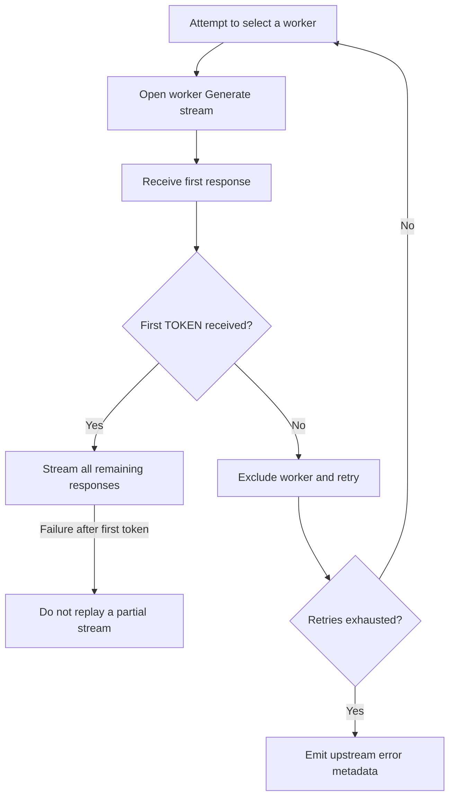
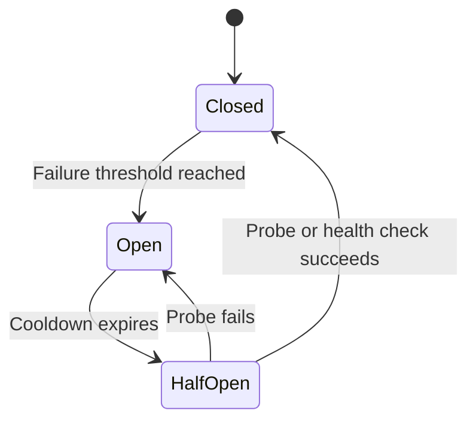
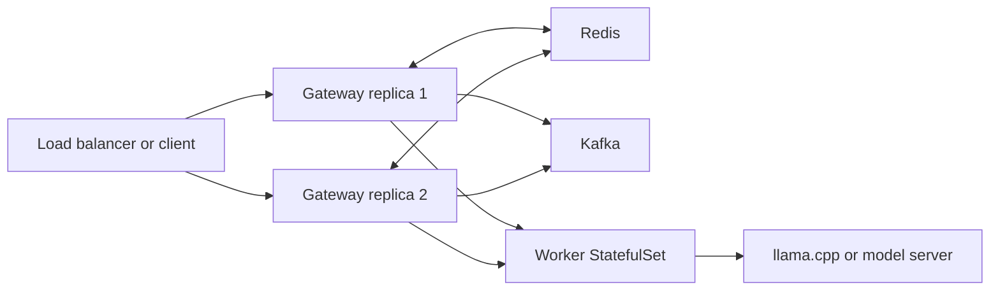

# Distributed LLM Gateway HLD

## Overview

This system is a distributed LLM inference gateway with HTTP and native gRPC
frontends. It supports mock workers for deterministic testing and llama.cpp
workers for real local inference.



## Request flow



## Prefix hashing and Redis storage

The prefix package normalizes the prompt by:

1. Lowercasing letters.
2. Collapsing whitespace.
3. Removing unsupported characters while processing the prompt.

It then divides the normalized prompt into blocks of 64 characters by default.
Hashes are cumulative rather than per word:

```text
Hash(block 1)
Hash(block 1 + block 2)
Hash(block 1 + block 2 + block 3)
```

Redis stores only the **worker affinity mapping**, not the prompt or KV-cache
contents.

```text
Redis key:   kv:<prefix-hash>
Redis value: worker-2
Redis TTL:   10 minutes by default
```

Conceptual Go operation:

```go
redis.Set(ctx, "kv:"+prefixHash, "worker-2", prefixTTL)
```



The worker has a separate approximate KV-cache map. It remembers received prefix
hashes and reports cache hits by counting prefixes already seen by that worker.

## Worker selection

The router uses the following precedence for smart routing:

1. **Longest prefix affinity:** check prefix hashes from longest to shortest.
2. **Consistent hash:** use the last prefix hash to deterministically choose a
   healthy ring member.
3. **Least-loaded fallback:** compare `in_flight / capacity`.

The consistent-hash ring contains only currently healthy worker IDs and uses
128 virtual nodes per worker. Adding or removing a worker remaps the ring.

Selecting `X-Routing-Policy: round-robin` bypasses cache affinity and consistently
hashing. The router rotates through eligible healthy workers.

If the requested model tier has no eligible worker, the router can fall back to
the `workhorse` tier.

## Admission and rate limiting

### Per-tenant rate limiting

The limiter implements a token bucket. Redis stores shared bucket state under:

```text
rl:<tenant-id>
```

Redis fields contain available tokens and the last update timestamp. The Lua
script adds tokens according to elapsed time and allows one request only when at
least one token is available.

Redis bucket state is shared across gateway replicas. When Redis is absent or
returns an error, each gateway process maintains an in-memory bucket instead.
Redis failures degrade to local enforcement; they do not fail open.

### AIMD admission control

Admission is a dynamic concurrency semaphore:

- The initial limit is half of `MAX_IN_FLIGHT`.
- Requests acquire a bounded queue slot before execution.
- `Success` events increase the limit additively after ten successes.
- A failed request halves the limit and resets the successful counter.
- The limit never drops below one or exceeds `MAX_IN_FLIGHT`.

Excess work waits up to `QUEUE_WAIT`, then is rejected.

## Worker behavior

A worker exposes two gRPC methods:

- `Generate`: server-streaming token generation.
- `Stats`: capacity, cache, throughput, and in-flight state.

### Mock mode

Mock workers use a deterministic random seed derived from the request ID.
They emit words from a fixed vocabulary at a configured tokens-per-second rate,
with optional timing jitter.

Mock workers can simulate:

- Requests above capacity.
- Failure of the first configured requests.
- Random backend failures.

### llama.cpp mode

llama.cpp workers send an HTTP streaming `/completion` request to llama.cpp,
with `cache_prompt: true`. llama.cpp may report cached token counts in SSE
events. The worker forwards generated content as gRPC `TOKEN` messages.

## Retries

The gateway retries only before the first token reaches the client.



Retry behavior prevents duplicated output: once any token has been sent,
subsequent upstream failure is reported instead of replaying the response through
another worker.

## Circuit breakers

Each worker has an independent circuit breaker.



- **Closed:** worker attempts are allowed.
- **Open:** attempts are blocked until cooldown expires.
- **Half-open:** one probe is allowed; another call is blocked while it runs.

The health loop refreshes worker stats every two seconds by default. Health success
can close a half-open breaker. Repeated call failures can open it based on the
configured sliding threshold and window.

## Failure modes

| Failure | Detection | Behavior | Result |
|---|---|---|---|
| Redis unavailable at startup | Redis ping fails | Gateway uses in-memory rate limits and prefix affinity | Shared Redis features degrade to process-local state |
| Redis fails after startup | Redis GET, SET, or Lua script returns an error | Prefix lookup misses; rate limiting falls back to local memory | Gateway continues running |
| Redis map entry is stale | Cached worker is unhealthy or excluded | Affinity lookup is ignored | Consistent hash or least-loaded fallback is used |
| Worker process unreachable | gRPC Stats refresh fails or Generate fails | Worker breaker receives failure; health ring removes it on health pass | Request routes to surviving worker |
| Worker at capacity | Worker in-flight count reaches capacity | Worker returns `ResourceExhausted` | Gateway reports or retries before first token |
| Worker fails during Generate | Generate RPC or stream returns error | Circuit breaker failure; retry if no token emitted | Next eligible worker is tried |
| Worker fails after first token | Stream receive returns upstream error | Gateway stops retrying | Client receives partial output and `upstream_error` |
| Circuit breaker open | Router checks breaker allowance | Worker is excluded from selection | Traffic goes to other workers |
| Half-open probe fails | Half-open worker returns failure | Breaker reopens | Worker is blocked through another cooldown |
| No healthy worker | No worker matches model and health state | Pipeline returns `no_worker` | HTTP/gRPC error is returned |
| Tenant rate exceeded | Token bucket has no available token | Request is counted as rate-limited | HTTP 429 or gRPC `ResourceExhausted` |
| Admission queue full or timeout expires | Dynamic limit or queue wait blocks request | Admission returns shed | HTTP 503 or gRPC `ResourceExhausted` |
| Client disconnect | Stream context or emit function returns error | Worker stream is canceled | Status becomes `client_disconnected` |
| Kafka unavailable | Kafka writes fail | Logging error is printed | Request handling continues |
| llama.cpp unavailable | HTTP completion request fails | Worker returns internal gRPC failure | Gateway may retry another worker |

## Metrics and observability

The gateway exposes Prometheus metrics on `:9091`:

- Request counts and request latency.
- Time to first token.
- Output tokens and rolling tokens/sec.
- Cache hit and miss estimates.
- Route decision reasons.
- Shed and retry counts.
- Per-worker circuit-breaker state.
- Per-worker in-flight requests.
- Admission limit, in-flight count, and queue depth.

The rolling tokens/sec gauge is used for KEDA or HPA worker autoscaling.

Completed requests can also be written asynchronously to Kafka. Each record
contains request ID, tenant, model, worker, route, status, token counts, cached
tokens, TTFT, and total latency.

## Deployment model



Workers are discovered through `WORKER_ADDRS`. Prefix affinity and rate limits
can be shared through Redis across gateway replicas.

For mock deployment, `make run-mocks` starts:

- Three worker processes on ports 9101-9103.
- HTTP gateway on port 8080.
- Native gateway gRPC on port 9090.
- Prometheus metrics on port 9091.

Redis and Kafka are optional. Without Redis, prefix affinity and rate limiting
remain in process memory. Without Kafka, request logging is a no-op.
