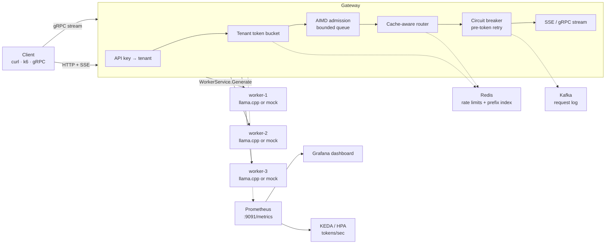
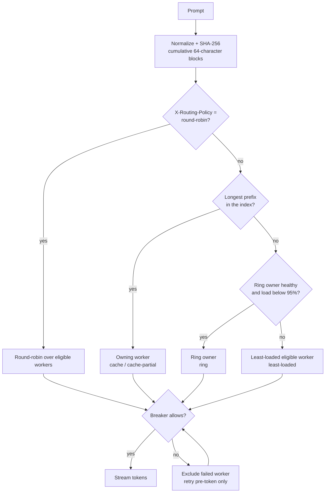

# Distributed LLM Inference Gateway — POC

[](https://go.dev/)
[](https://github.com/suhpin95/distributed-llm-inference-gateway/actions/workflows/ci.yml)
[](LICENSE)

A Go POC gateway in front of multiple model servers. It demonstrates token streaming,
KV-cache-aware routing, consistent hashing, load shedding, per-tenant rate limiting,
retries with backoff, circuit breakers, Kafka request logs, and autoscaling on
**tokens/sec** instead of CPU.

## Architecture



All backends implement one gRPC contract (`proto/inference.proto`), so the gateway
cannot tell a real llama.cpp worker from a deterministic mock.

## Requirements

- Go 1.27+ (`brew install go`), `make`
- Optional: Docker Desktop (one-command `docker compose` stack), `brew install k6`,
  `brew install llama.cpp` for real local inference

## Quickstart (no GPU, no Docker, no model download)

```bash
make test          # unit + integration tests
make run-mocks     # 3 mock workers + gateway on :8080, gRPC :9090, metrics :9091
```

In another terminal:

> **Note:** Ensure the gateway is running (e.g., with `make run-mocks`) before running the following commands.

```bash
# Token streaming (SSE)
curl -N -X POST http://127.0.0.1:8080/v1/chat/completions \
  -H 'Content-Type: application/json' -H 'Authorization: Bearer dev-key' \
  -d '{"model":"workhorse","messages":[{"role":"user","content":"Hello gateway"}],"stream":true}'

# Non-streaming, with routing metadata in the response
curl -s -X POST http://127.0.0.1:8080/v1/chat/completions \
  -H 'Content-Type: application/json' -H 'Authorization: Bearer dev-key' \
  -d '{"model":"workhorse","messages":[{"role":"user","content":"Explain prefix caching"}]}'

# Admin view of workers, breakers and cache hits
curl -s http://127.0.0.1:8080/admin/workers | python3 -m json.tool

# Prometheus metrics
curl -s http://127.0.0.1:9091/metrics | grep '^gateway_'

# Health check
curl http://127.0.0.1:8080/healthz

# Native gRPC streaming client
./bin/grpc-client -addr localhost:9090 -prompt 'Stream over gRPC'
```

To format the Go source or build the binaries without starting the services:

```bash
make fmt
make build
```

## 60-second demo (no Docker, no model)

```bash
make demo
```

`scripts/demo.sh` starts two deterministic mock workers plus the gateway on
`:8080/:9090/:9091`, then:

1. streams a chat completion over SSE,
2. repeats the same prompt so the gateway routes to the worker that already holds
   the prefix and `usage.cached_tokens` is non-zero,
3. kills that worker and retries the same prompt, showing a successful failover
   and a non-zero `gateway_retries_total` delta.

It prints the routing metadata and exits non-zero if either the cache-reuse or the
retry assertion fails. Stop any other gateway/workers first (ports 8080, 9090,
9091, 9101, 9102 must be free).

Expected tail:

```
Demo complete
  streaming:     OK
  prefix reuse:  cached_tokens=64
  failover:      served_by=worker-2 route=least-loaded retries=1
```

## One-command Docker stack

```bash
docker compose up --build
# or: make up
```

This starts the gateway, two mock workers, Redis, Prometheus, and Grafana:

| Service | URL |
|---|---|
| Gateway (OpenAI-compatible HTTP/SSE) | http://127.0.0.1:8080 |
| Gateway gRPC | `localhost:9090` |
| Gateway metrics | http://127.0.0.1:9091/metrics |
| Prometheus | http://127.0.0.1:9093 |
| Grafana (anonymous admin) | http://127.0.0.1:3000 |

The Prometheus datasource and the gateway dashboard are provisioned
automatically. Stop the stack with `docker compose down -v` (or `make down`).

## Routing

The router chooses one backend per request; a single request is never split across
workers.



1. **Round-robin override** — `X-Routing-Policy: round-robin` (or the gRPC
   `routing_policy` field) bypasses affinity and spreads requests evenly. This is
   the control used by `scripts/proof.sh`.
2. **Longest-prefix affinity** — prompts are normalized and split into cumulative
   SHA-256 blocks of 64 normalized characters. If the most specific block is in the
   prefix index, the owning worker is chosen (`cache`); a shorter match is
   `cache-partial`.
3. **Consistent-hash ring** — 128 virtual nodes per worker (FNV-32a). A ring owner
   is used only if it is healthy and its observed load is below 95% of capacity.
4. **Least-loaded fallback** — otherwise the eligible worker with the lowest
   in-flight/capacity ratio is chosen.
5. **Tier fallback** — if a request asks for a model tier with no healthy workers,
   the router falls back to `workhorse` (`tier-fallback`).

The health loop refreshes worker stats every 2s and rebuilds the ring from healthy
workers. Prefix-index entries are advisory: stale owners are ignored.

## Resilience controls

| Control | Default | Behaviour |
|---|---|---|
| Per-tenant token bucket | `TENANT_RATE=25`, `TENANT_BURST=50` | One token per request; a Redis Lua script shares the bucket across gateway replicas, with an in-memory bucket when Redis is absent. Rejections return `429` + `Retry-After: 1`. |
| AIMD admission | initial `32`, max `MAX_IN_FLIGHT=64` | Adds one slot after 10 consecutive successes; halves on failure. Excess requests wait up to `QUEUE_WAIT=500ms` in a `QUEUE_SIZE=32` queue, then get `429 overloaded` with `X-Shed-Reason: admission`. |
| Retry | `MAX_RETRIES=3` attempts, `RETRY_BASE=50ms` | Up to 3 total attempts (2 retries) with jittered backoff. Retries stop at the first token, so clients never see duplicate output. |
| Circuit breaker | 5 failures / 30s window, 5s cooldown | Per worker: closed → open after `BREAKER_FAILURE_THRESHOLD=5` failures within `BREAKER_WINDOW=30s`; after `BREAKER_COOLDOWN=5s` one half-open probe is allowed. Success closes it, failure re-opens it. |
| Health loop | `HEALTH_PERIOD=2s` | Refreshes worker stats, updates circuit state, and rebuilds the consistent-hash ring from healthy workers. |
| Prefix index | `PREFIX_TTL=10m`, `PREFIX_BLOCK_SIZE=64` | Advisory affinity hints; stale entries are ignored and never pin traffic to a dead worker. |

## API

### HTTP / SSE

| Method | Path | Notes |
|---|---|---|
| `POST` | `/v1/chat/completions` | OpenAI-compatible chat completion; `"stream": true` returns SSE. |
| `POST` | `/v1/completions` | Alias of the same handler; accepts `prompt`. |
| `GET` | `/healthz` | Liveness/readiness probe. |
| `GET` | `/admin/workers` | Worker health, breaker state, cache counters, in-flight/capacity. |
| `GET` | `/metrics` | Prometheus metrics on the HTTP mux (also `:9091/metrics`). |

Authenticate with `Authorization: Bearer dev-key` (the default tenant map is
`GATEWAY_TENANTS=dev-key:default`); `X-Tenant-Key` is also accepted. Optional
headers: `X-Request-ID`, `X-Routing-Policy: smart|round-robin`.

```bash
curl -s -X POST http://127.0.0.1:8080/v1/chat/completions \
  -H 'Content-Type: application/json' \
  -H 'Authorization: Bearer dev-key' \
  -d '{"model":"workhorse","messages":[{"role":"user","content":"Explain prefix caching"}],"max_tokens":32}'
```

Non-streaming responses include routing metadata:

```json
{
  "choices": [{"index": 0, "message": {"role": "assistant", "content": "..."}, "finish_reason": "stop"}],
  "usage": {"prompt_tokens": 6, "completion_tokens": 32, "cached_tokens": 64},
  "routing": {"worker": "worker-1", "reason": "cache"}
}
```

The same values are also sent as `X-Worker-ID`, `X-Route-Reason`,
`X-Served-Model`, and `X-Cached-Tokens` headers on non-streaming responses.

#### Streaming

Set `"stream": true` to receive `text/event-stream`:

```
data: {"id":"chatcmpl-...","object":"chat.completion.chunk","choices":[{"delta":{"role":"assistant"}}]}

data: {"id":"chatcmpl-...","object":"chat.completion.chunk","choices":[{"delta":{"content":"the"}}]}

...

data: [DONE]
```

Streaming responses commit headers before routing completes, so the `X-*` routing
headers are not available on the SSE response. Use `/admin/workers`,
`gateway_route_decisions_total`, and `gateway_cache_hits_total` to observe routing
for streamed requests. If rate limiting or admission rejects a stream after headers
are committed, the gateway emits an SSE `event: error` followed by `data: [DONE]`.

#### Errors

| Status | `error.type` | Cause |
|---|---|---|
| `400` | `invalid_request` | Malformed JSON or empty prompt/messages. |
| `401` | `invalid_api_key` | Unknown bearer token. |
| `429` | `rate_limit_exceeded` | Tenant token bucket empty; `Retry-After: 1`. |
| `429` | `overloaded` | AIMD queue full or wait exceeded; `X-Shed-Reason: admission`. |
| `503` | `no_backend` | No healthy worker for the requested tier. |
| `500` | `internal_error` | Unexpected pipeline failure. |

### gRPC

`GatewayService.Generate` on `:9090` streams the same `GenerateRequest` /
`GenerateResponse` contract as the worker API. The `DONE` message carries
`worker_id`, `tokens_generated`, `cached_tokens`, and the routing reason in
`message`.

```bash
./bin/grpc-client -addr localhost:9090 -prompt 'Stream over gRPC' -tokens 16
```

## Real local model (M2 Pro / 16 GB)

vLLM requires CUDA, so local inference uses **llama.cpp (Metal)** with a quantized
model. An 8B Q4_K_M model (~5 GB) fits comfortably in 16 GB unified memory.

```bash
brew install llama.cpp
# Download Qwen3-8B-Q4_K_M.gguf (base model) from Qwen/Qwen3-8B-GGUF on Hugging Face, then:
export LLAMA_MODEL_PATH=/path/to/Qwen3-8B-Q4_K_M.gguf
make run-real
```

`scripts/run-real.sh` starts llama.cpp on `:8081`, one llama worker agent on `:9101`,
and two mock replicas on `:9102/:9103`. The worker sends `cache_prompt: true` to
llama.cpp so repeated prefixes actually reuse KV blocks; the gateway's own prefix
index additionally prefers the worker that already holds a prefix.
If `LLAMA_MODEL_PATH` is unset, `make run-real` starts the mock path instead.

For a lightweight real-inference proof, use `Qwen3-0.6B-Q8_0.gguf` from
`Qwen/Qwen3-0.6B-GGUF` (~0.64 GB), the only quantization published in that repo:

```bash
mkdir -p models
curl -L -o models/Qwen3-0.6B-Q8_0.gguf \
  https://huggingface.co/Qwen/Qwen3-0.6B-GGUF/resolve/main/Qwen3-0.6B-Q8_0.gguf
make ttft
```

`make ttft` starts llama.cpp, a single llama-mode worker, and the gateway, then
measures cold (full prefill) versus warm (KV-cache reuse) TTFT. See
[Measured results — real inference](#measured-results--real-inference) for the
numbers produced on this machine.

No frontier-class model is configured: a 16 GB M2 Pro cannot host one, and none is
simulated. The `tier=host:port` syntax in `WORKER_ADDRS` is generic, so a hosted
endpoint can be added later without gateway changes.

## Infrastructure (optional)

```bash
make infra        # Redis :6379, Kafka :9092, Prometheus :9093
REDIS_ADDR=localhost:6379 KAFKA_BROKERS=localhost:9092 make run-mocks
```

Kafka receives one JSON record per request on topic `inference-requests`
(`request_id`, tenant, model, worker, route, cached_tokens, TTFT, status, ...).
With no brokers configured, logging is a no-op.

Stop the optional infrastructure with:

```bash
make infra-down
```

## Load testing

With the mock gateway running, start it with higher admission limits:

```bash
TENANT_RATE=50000 \
TENANT_BURST=100000 \
MAX_IN_FLIGHT=200 \
QUEUE_SIZE=200 \
make run-mocks
```

In another terminal, run the k6 load test (install k6 first, for example with
`brew install k6`):

```bash
make k6
```

## Testing and CI

CI runs on every push to `master` and every pull request (`.github/workflows/ci.yml`):

- `gofmt` check, `go vet`, and `golangci-lint` with the config in `.golangci.yml`
- `go test -race ./...`
- Docker builds for the gateway and worker images

The suite covers config defaults and overrides, the prefix index, worker cache
accounting, address parsing, and the routing/resilience paths end to end against
real gRPC workers:

| Test | What it proves |
|---|---|
| `TestStreamingCacheAffinityAndFailover` | A repeated prefix routes to its cache owner, and traffic survives a backend being killed. |
| `TestRetryBeforeFirstToken` | A pre-token failure is retried on another worker without duplicate output. |
| `TestFailoverThirtyNineRequestsOneRetry` | 39/39 requests succeed with exactly one retry when a worker rejects its first request. |
| `TestRoundRobinOverrideSpreadsAcrossWorkers` | `X-Routing-Policy: round-robin` reaches every eligible worker. |
| `TestTierFallbackToWorkhorse` | A request for an empty tier falls back to `workhorse` (`tier-fallback`). |

Run everything locally with:

```bash
go test -race ./...
```

## The proofs

| Proof | How to reproduce |
|---|---|
| **p99 under load** | Start the gateway with `TENANT_RATE=50000 TENANT_BURST=100000 MAX_IN_FLIGHT=200 QUEUE_SIZE=200 make run-mocks`, then `make k6` (ramp 0→100 VUs, 80% shared prefixes). Read `http_req_duration p(99)` in the k6 summary or Grafana. |
| **Backend dies** | `bash scripts/failover-demo.sh` — kills worker-2 mid-traffic, then prints breaker states, retries, route decisions. |
| **Cache hit improvement** | `bash scripts/proof.sh` — runs identical k6 workloads with `X-Routing-Policy: round-robin` and `smart`, printing cache hit counters and p99. |
| **Load shedding** | Raise k6 target or lower `MAX_IN_FLIGHT`; watch `gateway_shed_total` climb while p99 stays bounded and clients get `429 + Retry-After`. |
| **Real-inference TTFT** | Download `Qwen3-0.6B-Q8_0.gguf`, then `make ttft` — starts llama.cpp + one real worker and prints cold vs warm TTFT. |

Expected behavior: smart routing concentrates shared prefixes on few workers,
raising `gateway_cache_hits_total` and lowering TTFT/p99 versus round-robin;
killing a backend opens its circuit (metric `gateway_circuit_state=1`), traffic
moves to survivors, and pre-first-token failures are retried on another worker.

## Observability

The compose stack provisions Prometheus and Grafana with the dashboard in
`dashboards/grafana.json`; open http://127.0.0.1:3000 after
`docker compose up --build`. Key metrics:

| Metric | Meaning |
|---|---|
| `gateway_requests_total` | Requests by tenant, model, and status. |
| `gateway_request_duration_seconds` | End-to-end latency histogram (p50/p99 panels). |
| `gateway_ttft_seconds` | Time to first token by model and route reason. |
| `gateway_output_tokens_per_second` | Rolling output throughput; the KEDA/HPA signal. |
| `gateway_cache_hits_total` / `gateway_cache_misses_total` | Prefix-affinity hit ratio. |
| `gateway_route_decisions_total` | Routing reasons (`cache`, `ring`, `least-loaded`, `round-robin`, `tier-fallback`). |
| `gateway_retries_total` | Pre-token retry attempts. |
| `gateway_shed_total` | Rejections by reason (`rate-limit`, `admission`, `worker-unreachable`). |
| `gateway_circuit_state` | `0` closed, `0.5` half-open, `1` open. |
| `gateway_admission_limit` / `_in_flight` / `_queued` | AIMD state. |

The dashboard panels cover request p50/p99, TTFT p99, output tokens/sec,
prefix-cache hit ratio, circuit-breaker state, and shed/retry rates. Import
`dashboards/grafana.json` manually if you run Prometheus outside the compose stack.

## Measured results — real inference

Measured on an **Apple M2 Pro (16 GB unified memory)** with **Qwen3-0.6B-Q8_0.gguf**
(610 MB) served by **llama.cpp with Metal**, one llama-mode worker behind the
gateway, and `bash scripts/ttft-proof.sh` (5 trials, `max_tokens=8`, ~1.1k-token
prompts). A cold request uses a fresh prompt (full prefill); the warm request repeats
the identical prompt so llama.cpp reuses KV blocks (`cache_prompt: true`). TTFT is
measured client-side from request start to the first content token.

The latest 5-trial run:

| Cold median | Warm median | Cold p95 | Warm p95 | Reduction |
|---:|---:|---:|---:|---:|
| 115.6 ms | 8.3 ms | 121.6 ms | 8.4 ms | 93% (13.9×) |

Warm TTFT is **~93% lower (13.9× faster)** than cold. The warm
non-streaming probe reported `cached_tokens=1152`, `route=cache`, `worker=worker-1`,
confirming both the gateway's prefix affinity and llama.cpp's KV reuse. These are
single-request, single-worker numbers on one machine, not a throughput benchmark.

## Measured results — mock workers

All figures below were measured on an **Apple M2 Pro (16 GB unified memory)** with
`make run-mocks` (three deterministic Go mock workers) and `make k6` (ramp 0→100 VUs,
80% shared prefixes). The mocks emit synthetic tokens and simulate KV-cache hits;
**no model was loaded and no GPU was used**. These numbers demonstrate the gateway's
routing and admission behaviour only — they are **not** real-model inference
benchmarks.

| Metric | Result | Source |
|---|---|---|
| Throughput | **71.3 req/s** | k6 `http_reqs` at peak load |
| Cache hit rate | **79%** | `gateway_cache_hits_total / (hits + misses)` |
| Smart routing vs round-robin | **+7.5%** | `scripts/proof.sh`, same workload, both policies |
| p99 latency | **975 ms** | k6 `http_req_duration p(99)` under the same load |

Reproduce them with the commands in [The proofs](#the-proofs).

## Configuration

All settings are environment variables. Key knobs:

| Variable | Default | Purpose |
|---|---|---|
| `WORKER_ADDRS` | `localhost:9101,...` | Workers; optional `tier=host:port` names a tier (none configured by default). |
| `GATEWAY_TENANTS` | `dev-key:default` | API key → tenant map. |
| `TENANT_RATE` / `TENANT_BURST` | `25` / `50` | Per-tenant token bucket. |
| `MAX_IN_FLIGHT` / `QUEUE_SIZE` / `QUEUE_WAIT` | `64` / `32` / `500ms` | AIMD admission limit, bounded queue, and max queue wait. |
| `MAX_RETRIES` / `RETRY_BASE` | `3` / `50ms` | Total pre-token attempts (3 = 2 retries) with jittered backoff. |
| `BREAKER_FAILURE_THRESHOLD` / `BREAKER_WINDOW` / `BREAKER_COOLDOWN` | `5` / `30s` / `5s` | Circuit breaker failure threshold, sliding window, and open cooldown. |
| `HEALTH_PERIOD` | `2s` | Worker stats refresh and ring rebuild interval. |
| `PREFIX_TTL` / `PREFIX_BLOCK_SIZE` | `10m` / `64` | Prefix index lifetime and block size in normalized characters. |
| `REDIS_ADDR` / `KAFKA_BROKERS` | empty | Enable shared state / request logs. |
| `WORKER_MODE`, `WORKER_FAILURE_RATE`, `WORKER_TOKENS_PER_SEC` | `mock`, `0`, `45` | Worker behavior in tests. |

## Kubernetes / autoscaling

```bash
docker build -f Dockerfile.gateway -t inference-gateway:latest .
docker build -f Dockerfile.worker  -t inference-worker:latest .
# with kind:
kind load docker-image inference-gateway:latest inference-worker:latest
kubectl apply -f deploy/k8s/gateway.yaml
kubectl apply -f deploy/k8s/workers.yaml
kubectl apply -f deploy/k8s/autoscale.yaml   # requires KEDA + Prometheus Operator
```

`deploy/k8s/autoscale.yaml` scales the worker StatefulSet on
`sum(gateway_output_tokens_per_second)` (threshold 40 tok/s, 2–8 replicas)
instead of CPU. For plain HPA, expose the same metric through the Prometheus
Adapter and point an `HorizontalPodAutoscaler` at it.

## Design notes / limitations

- **Retries stop at the first token**: once output has been emitted, an upstream
  failure is surfaced as `upstream_error` rather than replaying duplicate tokens.
- **Prefix index is advisory**: stale entries pointing at dead workers are
  ignored; the consistent-hash ring and health checks keep routing correct.
- **Mocks are deterministic** so k6 results are reproducible. The real llama.cpp
  worker is for end-to-end fidelity; use several GPU hosts/vLLM for a production
  version of the multi-replica story.
- **No frontier tier is configured**: the local M2 Pro cannot host a frontier-class
  model and no hosted endpoint is wired in. Tier routing is generic
  (`tier=host:port`) and falls back to `workhorse` when a tier has no healthy workers.
- The POC uses in-process metrics on `:9091` and a separate HTTP mux on `:8080`;
  no service mesh or TLS is included.
